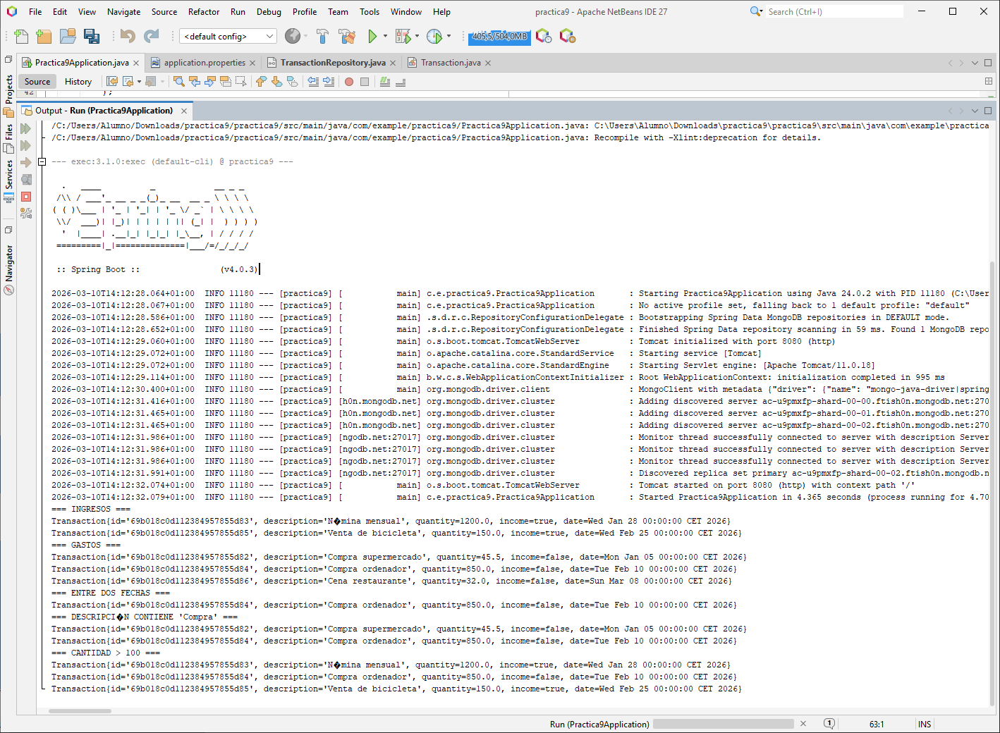
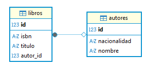
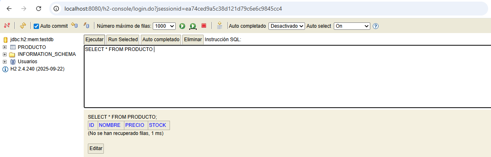

<div align="center">
  
</div>

<div align="center">
  <a href="https://github.com/evagr11/ADD-NDT" target="_blank"></a>
  <a href="#-índice-de-contenidos"></a>
</div>

<div align="center">
  <a href="https://git.io/typing-svg"></a>
</div>

# 🚀 Sobre el Proyecto

**ADD-NDT** reúne todos mis apuntes, prácticas y exámenes de la asignatura **Acceso a Datos**: desde leer y escribir ficheros en Java hasta montar una API REST con Spring Boot o guardar documentos en MongoDB Atlas. Cada tema tiene sus apuntes en Markdown y cada práctica incluye el código completo, explicado paso a paso, con capturas de la ejecución.

```java
public class AccesoADatos {
    String modulo = "ADD-NDT";
    String ciclo  = "DAM - 2º Curso";

    String[] contenidos = {
        "Gestión de ficheros y directorios",
        "Flujos de datos (Streams)",
        "XML con DOM y XPath",
        "JDBC y PostgreSQL",
        "Spring Boot con H2",
        "ORM con Hibernate y JPA",
        "APIs REST con Spring Boot",
        "NoSQL con MongoDB"
    };

    public void objetivo() {
        // Dominar la persistencia de datos en todas sus formas
    }
}
```

✨ **Características principales:**

*   📖 **Apuntes por tema:** Teoría resumida en Markdown, con ejemplos de código para cada concepto.
*   💻 **Prácticas completas:** Enunciado, código final comentado y capturas de cada paso (NetBeans, DBeaver, Postman, H2 Console, MongoDB Atlas).
*   🎯 **Exámenes prácticos:** Los dos exámenes trimestrales con su código y el proyecto comprimido.
*   🧭 **Recorrido completo:** De los ficheros planos a las bases de datos relacionales, el ORM, las APIs REST y el NoSQL, en el orden en que se aprende.

### Galería de Prácticas

| API REST probada con Postman (Tema 8) | Consultas a MongoDB Atlas (Tema 9) |
| :-----------------------------------: | :--------------------------------: |
|  |  |
| *Alta de un autor con `POST /autores` y respuesta `201 Created`.* | *Ingresos, gastos y filtros por fecha, texto y cantidad.* |
| **Relación Autor ↔ Libro en DBeaver (Tema 7)** | **Consola H2 con Spring Boot (Tema 6)** |
|  |  |
| *Relación 1:N generada con JPA.* | *Base de datos embebida accesible desde el navegador.* |

# 🧠 Contexto del Proyecto

Este repositorio corresponde a la asignatura **Acceso a Datos** del ciclo formativo de **Desarrollo de Aplicaciones Multiplataforma (DAM)**, que cursé en **New Digital Talent** (de ahí el **NDT** del nombre). Empezó con la evaluación inicial de la asignatura y fue creciendo tema a tema hasta el examen del segundo trimestre.

Lo organicé así para tener en un único sitio la teoría, el código que funciona y la prueba de que funciona, y poder volver a cualquier tema sin tener que rehacer la práctica. La siguiente etapa de la asignatura está en [acceso-a-datos](https://github.com/evagr11/acceso-a-datos).

# 🛠️ Stack Tecnológico

<div align="center">
  
  
  
  
  
  
  
  
  
  
  
</div>

<br>

<div align="center">

| Área | Tecnología |
| :--- | :--------- |
| **Lenguaje** | `Java` |
| **Ficheros y XML** | `java.io`, `DOM`, `XPath`, `Transformer` |
| **Bases de datos** | `PostgreSQL`, `H2`, `MongoDB Atlas` |
| **Persistencia** | `JDBC`, `Hibernate`, `Spring Data JPA`, `Spring Data MongoDB` |
| **Backend** | `Spring Boot`, `Spring Web` (APIs REST) |
| **Herramientas** | `NetBeans`, `Eclipse`, `DBeaver`, `Postman`, `Maven` |

</div>

# 🧭 Índice de Contenidos

<div align="center">

| Bloque | Tema | Contenido |
| :----: | :--- | :-------- |
| 🧪 | [Evaluación inicial](#-evaluación-inicial) | Prueba de nivel de Java y SQL |
| `I` | [Tema 1: Ficheros y Directorios](#-tema-1-ficheros-y-directorios) | Apuntes · 2 ejercicios · Práctica final |
| `I` | [Tema 2: Flujos de Datos](#-tema-2-flujos-de-datos-avanzados) | Apuntes · Preguntas |
| `I` | [Tema 3: XML con DOM y XPath](#-tema-3-procesamiento-xml-dom--xpath) | Apuntes · Práctica · Práctica final |
| `I` | [Tema 4: JDBC y PostgreSQL](#-tema-4-jdbc-y-postgresql) | Apuntes · Práctica 4 · Práctica final |
| 🎯 | [Examen 1er Trimestre](#-examen-1er-trimestre) | XML + DAO + JDBC |
| `II` | [Tema 6: Spring Boot + H2](#-tema-6-spring-boot--h2) | Práctica 5 · Ejercicio 5 |
| `II` | [Tema 7: ORM con Hibernate y JPA](#-tema-7-orm-con-hibernate-y-jpa) | Apuntes 7.1 y 7.2 · Práctica 7 · Guía de Eclipse |
| `II` | [Tema 8: APIs REST](#-tema-8-apis-rest-con-spring-boot) | Apuntes · Práctica 8 (2 partes) · Códigos |
| `II` | [Tema 9: NoSQL y MongoDB](#-tema-9-nosql-y-mongodb) | Apuntes 9.1, 9.2 y 9.3 · Práctica 9 |
| 🎯 | [Examen 2º Trimestre](#-examen-2º-trimestre) | Spring Data MongoDB |

</div>

<br>

## 🧪 Evaluación Inicial

📍 [`EvaluaciónInicial.md`](EvaluaciónInicial.md)

Prueba de nivel no calificable del inicio de la asignatura, con preguntas de **Programación (Java)**: clases y objetos, excepciones, herencia… y de **Bases de Datos (SQL)**.

---

## 🟦 Tema 1: Ficheros y Directorios

<p align="center">
  
  
  
  
</p>

📖 **Apuntes:** [`TEMA1/Apuntes_Tema1.md`](TEMA1/Apuntes_Tema1.md): clase `File`, acceso secuencial por bytes y por caracteres y acceso aleatorio.

### 📚 Ejercicio Final 1: Biblioteca con directorios y ficheros
📍 [`TEMA1/Ejercicio_Final1.md`](TEMA1/Ejercicio_Final1.md)

<div align="center">

| 🎯 Concepto | 📝 Descripción |
| :---------: | :------------- |
| 📁 | Creación de directorios y subdirectorios |
| 📄 | Creación de archivos `catalogo.txt` |
| 🔢 | Escritura y lectura con **bytes** (Novela) |
| 🔤 | Escritura y lectura con **caracteres** (Poesía) |
| 🎲 | Escritura y lectura con **acceso aleatorio** (Ciencia) |
| 📋 | Listado del contenido de la biblioteca |

</div>

### 🎬 Ejercicios Tema 1: cine_granada y días de la semana
📍 [`TEMA1/Ejercicios_Tema1.md`](TEMA1/Ejercicios_Tema1.md)

<div align="center">

| # | Ejercicio | Tipo |
| :-: | :-------- | :--: |
| 1 | Crear el directorio `cine_granada` |  |
| 2 | Crear los directorios de los días de la semana |  |
| 3 | Mover los directorios dentro de `cine_granada` |  |
| 4 | Comprobaciones de existencia |  |
| 5 | Mostrar la ruta absoluta al crear |  |
| 6 | Listar los archivos creados |  |
| 7 | Crear `sesiones.txt` en cada día |  |
| 8 | Escritura y lectura con **bytes** |  |
| 9 | Escritura y lectura con **caracteres** |  |
| 10 | Escritura y lectura con **acceso aleatorio** |  |

</div>

### 🍿 Práctica Final 1: Reviews de películas
📍 [`TEMA1/Practica_Final1.md`](TEMA1/Practica_Final1.md)

<p align="center">
  
  
  
</p>

**🎭 Clases principales:** `User` | `Review`

**⚙️ Funcionalidades:**
- 👤 Crear y eliminar usuarios
- ⭐ Añadir y mostrar reviews
- 💾 Persistencia en `users.txt` y `reviews/Nombre-ID.txt`

---

## 🟦 Tema 2: Flujos de Datos Avanzados

<p align="center">
  
  
  
</p>

📖 **Apuntes:** [`TEMA2/Apuntes_Tema2.md`](TEMA2/Apuntes_Tema2.md): streams de ficheros y arrays, tuberías entre hilos, análisis de flujos y datos primitivos.

### 📘 Preguntas sobre flujos de datos
📍 [`TEMA2/Preguntas.md`](TEMA2/Preguntas.md)

<div align="center">

| 🔧 Componente | 📝 Descripción |
| :------------ | :------------- |
| `PushbackReader` | Métodos `read()` y `unread()` para devolver caracteres al buffer |
| `PipedInputStream` / `PipedOutputStream` | Comunicación entre hilos mediante tuberías |
| `StreamTokenizer` | Tokenización de texto: palabras, números y símbolos |
| `LineNumberReader` | Lectura con contador automático de líneas |
| `DataInputStream` | Lectura de datos primitivos; importancia del orden y manejo de **EOFException** |

</div>

---

## 🟦 Tema 3: Procesamiento XML (DOM + XPath)

<p align="center">
  
  
  
  
</p>

📖 **Apuntes:** [`TEMA3/Apuntes_Tema3.md`](TEMA3/Apuntes_Tema3.md)

### 📘 Práctica: Parseador DOM básico
📍 [`TEMA3/Practica.md`](TEMA3/Practica.md)

<div align="center">

| 🔧 Componente | 📝 Descripción |
| :------------ | :------------- |
| `DocumentBuilderFactory` / `DocumentBuilder` | Creación del parser DOM |
| Lectura DOM | Carga del XML en memoria como árbol |
| XPath (`/class/student`) | Consultas selectivas sobre nodos |
| Recorrido de nodos | Extracción de atributos y elementos |

</div>

### 🛒 Práctica Final DOM: Gestor de productos
📍 [`TEMA3/PracticaFinalDOM/PracticaFinalDOM.md`](TEMA3/PracticaFinalDOM/PracticaFinalDOM.md) · Código: [`CodigosCompletos.md`](TEMA3/PracticaFinalDOM/CodigosCompletos.md)

**🧭 Menú interactivo:**
1. 📄 Mostrar productos
2. ➕ Añadir producto
3. 💲 Incrementar precios por categoría

<div align="center">

| Archivo | Contenido |
| :------ | :-------- |
| `DOMManager` | Gestión centralizada del parser DOM |
| `GestorProductosXML` | CRUD completo sobre productos |
| `productos.xml` | Ejemplo real de estructura XML |

</div>

Los cambios se guardan en el XML con `Transformer`, e incluye validaciones y mejoras propuestas.

---

## 🟦 Tema 4: JDBC y PostgreSQL

<p align="center">
  
  
  
  
</p>

📖 **Apuntes:** [`TEMA4/Apuntes_Tema4.md`](TEMA4/Apuntes_Tema4.md)

### 🗄️ Práctica 4: Base de datos con PostgreSQL
📍 [`TEMA4/Practica4/Practica4.md`](TEMA4/Practica4/Practica4.md)

<div align="center">

| 🔧 Tarea | 📝 Descripción |
| :------- | :------------- |
| 🛠️ Instalación | Instalación y configuración inicial de PostgreSQL |
| 👤 Usuario y BD | Creación del usuario y de la base de datos `tema4` |
| 🧱 Tabla `Usuarios` | Definición y creación de la tabla |
| 🔌 Conexión JDBC | Conexión desde Java mediante `DriverManager` |
| 🔍 Consultas SQL | Ejecución de consultas `SELECT` |

</div>

### 🧩 Práctica Final: Conexión, tablas y DAO
📍 [`TEMA4/PracticaFinal.md`](TEMA4/PracticaFinal.md)

Configuración de la conexión, creación de las tablas, clases auxiliares, **clases DAO** y una clase `Main` con menú para manejarlo todo.

---

## 🎯 Examen 1er Trimestre

<p align="center">
  
  
  
  
</p>

📍 [`examen_1er_trimestre/examen.md`](examen_1er_trimestre/examen.md) · Proyecto: [`examen_1er_trimestre.zip`](examen_1er_trimestre/examen_1er_trimestre.zip)

<div align="center">

| Archivo | Función |
| :------ | :------ |
| `ConfiguracionXML.java` | Lee `config.xml` con **DOM** y **XPath** y valida los parámetros de conexión |
| `AlumnoDAO.java` | Comunicación con la base de datos mediante `PreparedStatement` y `ResultSet` |
| `Alumno.java` | Modelo del alumno: atributos, constructores, getters y setters |
| `Main.java` | Carga la configuración, conecta con `DriverManager`, pide datos con `Scanner` y orquesta el DAO |

</div>

---

## 🟦 Tema 6: Spring Boot + H2

<p align="center">
  
  
  
  
</p>

### ⚙️ Práctica 5: Spring Boot + Base de Datos H2
📍 [`TEMA6/Practica5/Practica5.md`](TEMA6/Practica5/Practica5.md)

<div align="center">

| 🔧 Tarea | 📝 Descripción |
| :------- | :------------- |
| Configuración inicial | Proyecto creado con **Spring Initializr** (Maven + Java) |
| Dependencias | H2 Database • Spring Data JPA • Spring Web |
| `application.properties` | Activación de la BD embebida y de la **H2 Console** |
| `data.sql` | Creación automática de tablas y datos iniciales |
| `h2-console` | Acceso y administración de las tablas desde el navegador |

</div>

### 🖥️ Ejercicio 5: Gestión de procesos y persistencia
📍 [`TEMA6/Ejercicio5/Ejercicio5.md`](TEMA6/Ejercicio5/Ejercicio5.md)

**🧪 Notas técnicas:** comprobar el puerto **8080** con `netstat` y cerrar procesos por **PID** con `taskkill`.

<div align="center">

| Tabla | Campos |
| :---- | :----- |
| **Usuarios** | `id` (SERIAL), `nombre` (VARCHAR) |
| **Productos** | `id`, `nombre`, `precio` (DECIMAL) |
| **Pedido** | Relaciones con usuarios y productos mediante **claves foráneas** |

</div>

**🧩 Clases Java:** `MenuPrincipal` · `AnadirUsuario` · `AnadirProducto` · `AnadirPedido` · `ConexionBD`

---

## 🟦 Tema 7: ORM con Hibernate y JPA

<p align="center">
  
  
  
  
</p>

### 📘 Tema 7.1: ORM e Hibernate
📍 [`TEMA7/Apuntes_Tema7.1.md`](TEMA7/Apuntes_Tema7.1.md)

<div align="center">

| 🔧 Concepto | 📝 Descripción |
| :---------- | :------------- |
| ORM | Puente entre la POO y las bases de datos relacionales |
| Equivalencias | **Clases ↔ Tablas**, **Objetos ↔ Filas**, **Atributos ↔ Columnas** |
| Herramientas | Hibernate • iBatis • EBean |
| Componentes de Hibernate | Objetos de persistencia • `.properties` • HQL |

</div>

### 🧩 Tema 7.2: Clases persistentes y operaciones
📍 [`TEMA7/Apuntes_Tema7.2.md`](TEMA7/Apuntes_Tema7.2.md)

<div align="center">

| Apartado | Contenido |
| :------- | :-------- |
| 🧱 Clases persistentes | Constructor por defecto, atributo **ID** y encapsulamiento |
| 🏷️ Anotaciones JPA | `@Entity` · `@Table` · `@Id` · `@GeneratedValue` |
| 🗄️ `application.properties` | URL de conexión, usuario, contraseña y `spring.jpa.hibernate.ddl-auto` |
| 🔄 Operaciones CRUD | `.persist()` · `.get()` · `.delete()` · `.merge()` |
| 🔍 Consultas avanzadas | `CriteriaBuilder` · `CriteriaQuery` · `Root` |

</div>

### 🛠️ Práctica 7: Relaciones y CRUD
📍 [`TEMA7/Practica7/Practica7.md`](TEMA7/Practica7/Practica7.md)

<div align="center">

| 🔧 Tarea | 📝 Descripción |
| :------- | :------------- |
| Instalación | PostgreSQL + DBeaver |
| Proyecto | Creación con Spring Initializr + JPA |
| Relaciones | Ejemplo **Autor ↔ Libro** (1:N) |
| Service | Métodos de inserción, borrado, actualización y búsqueda |

</div>

### 🖥️ Guía de Eclipse y Spring Boot
📍 [`TEMA7/Practica7/ApuntesEclipse.md`](TEMA7/Practica7/ApuntesEclipse.md)

Creación de proyectos **Maven**, configuración del **JDK 17** y solución de errores de versión del JRE.

---

## 🟦 Tema 8: APIs REST con Spring Boot

<p align="center">
  
  
  
  
</p>

### 📘 Apuntes del Tema 8: Implementación de APIs en Java
📍 [`TEMA8/Apuntes_Tema8.md`](TEMA8/Apuntes_Tema8.md)

<div align="center">

| 🔧 Concepto | 📝 Descripción |
| :---------- | :------------- |
| `@RestController` | Punto de entrada de la API |
| `@RequestMapping` | Rutas con buenas prácticas (sustantivos, minúsculas, guiones) |
| `@Autowired` | Inyección de dependencias para delegar la lógica |
| `ResponseEntity` + `HttpStatus` | Respuestas personalizadas (200, 201, 204, 404) |

</div>

### 🛠️ Práctica 8.1: API básica
📍 [`TEMA8/Practica8/Practica8_parte1.md`](TEMA8/Practica8/Practica8_parte1.md)

<div align="center">

| Funcionalidad | Descripción |
| :------------ | :---------- |
| Controlador básico | Gestión de recursos sin claves externas |
| `POST` | Inserción de objetos con `@RequestBody` |
| `PUT` | Actualización con `@PathVariable` y `@RequestParam` |
| `GET` | Búsqueda por ID y listados generales |
| Filtros personalizados | Consultas GET por atributos (por ejemplo, nombre) |

</div>

### 🔗 Práctica 8.2: APIs con relaciones y claves externas
📍 [`TEMA8/Practica8/Practica8_parte2.md`](TEMA8/Practica8/Practica8_parte2.md)

<div align="center">

| Funcionalidad | Descripción |
| :------------ | :---------- |
| Relaciones | Controladores con entidades que tienen claves externas |
| `POST` validado | Comprueba que existe la relación externa (404 si no existe) |
| `PUT` | Actualización de atributos simples y de relaciones |
| `DELETE` | Eliminación con validación previa |
| `GET` vinculado | Datos relacionados con mensajes descriptivos |

</div>

### 📂 Códigos completos y pruebas
📍 [`TEMA8/Practica8/CódigosCompletosP8.md`](TEMA8/Practica8/CódigosCompletosP8.md)

Clases finales **Autor** y **Libro** con sus controladores y servicios, capturas de **Postman** con pruebas reales (POST, PUT, DELETE, GET) y las tablas *autores* y *libros* en **DBeaver**.

---

## 🟦 Tema 9: NoSQL y MongoDB

<p align="center">
  
  
  
  
</p>

### 📘 Tema 9.1: Introducción a NoSQL
📍 [`TEMA9/Apuntes_Tema9.1.md`](TEMA9/Apuntes_Tema9.1.md)

<div align="center">

| 🔧 Concepto | 📝 Descripción |
| :---------- | :------------- |
| NoSQL | Bases de datos con esquemas flexibles (JSON) |
| Clúster | Escalabilidad, alta disponibilidad, resiliencia y balanceadores |
| Escalabilidad | **Vertical** (hardware) frente a **horizontal** (nodos) |
| Tipos de NoSQL | Clave-valor • Documentos • Columnas • Grafos |

</div>

### 🍃 Tema 9.2: MongoDB y teorema CAP
📍 [`TEMA9/Apuntes_Tema9.2.md`](TEMA9/Apuntes_Tema9.2.md)

<div align="center">

| Apartado | Contenido |
| :------- | :-------- |
| 🧩 Características | Almacenamiento en **BSON**, **replica sets** y escalabilidad horizontal |
| 📚 Terminología | **Colección** ≈ tabla · **Documento** ≈ fila |
| 🔺 Teorema CAP | **C**onsistencia · Disponibilidad (**A**vailability) · Tolerancia a **P**articiones. MongoDB es **CP** |
| ☁️ MongoDB Atlas | Servicio en la nube (SaaS) para gestionar clústeres |

</div>

### 🛠️ Tema 9.3: Integración con Spring Boot
📍 [`TEMA9/Apuntes_Tema9.3.md`](TEMA9/Apuntes_Tema9.3.md)

<div align="center">

| Componente | Descripción |
| :--------- | :---------- |
| Spring Data MongoDB | Persistencia de documentos flexibles |
| `application.properties` | Cadena de conexión al clúster |
| `@Document` | Marca una clase como colección |
| `@Id` | Identificador del documento |
| `@Field` | Nombre personalizado del campo |
| `MongoRepository` | CRUD automático y consultas por palabras clave |

</div>

### 💰 Práctica 9: Control de gastos e ingresos
📍 [`TEMA9/Practica9/Practica9.md`](TEMA9/Practica9/Practica9.md)

<div align="center">

| Apartado | Contenido |
| :------- | :-------- |
| 🧱 Configuración | Clúster en **MongoDB Atlas**, usuario administrador y conexión remota |
| 🧩 Clase `Transaction` | ID, descripción, cantidad, tipo (ingreso o gasto) y fecha |
| 🔍 Repositorio | Filtros por fechas, por descripción (por ejemplo, "Compra") y por rangos de cantidad |
| 🚀 Inicialización | `CommandLineRunner` para limpiar y cargar datos de prueba en la nube |

</div>

---

## 🎯 Examen 2º Trimestre

<p align="center">
  
  
  
</p>

📍 [`examen_2do_trimestre/examen.md`](examen_2do_trimestre/examen.md) · Proyecto: [`examen_2o_trimestre.zip`](examen_2do_trimestre/examen_2o_trimestre.zip)

Aplicación Spring Boot que guarda **Pokémon** en una colección de MongoDB Atlas y los consulta con métodos derivados de `MongoRepository`.

<div align="center">

| Archivo | Función |
| :------ | :------ |
| `Pokemon.java` | Documento con nombre, tipo, nivel, entrenador y fecha de captura |
| `PokemonRepository.java` | Consultas por tipo, nivel mínimo, rango de niveles, fecha y nombre |
| `Practica9Application.java` | Limpia la colección, carga los datos y muestra el resultado de cada consulta |

</div>

<br>

# 📂 Estructura del Proyecto

```bash
ADD-NDT/
├── EvaluaciónInicial.md
├── TEMA1/                     # Ficheros y directorios
│   ├── Apuntes_Tema1.md
│   ├── Ejercicio_Final1.md
│   ├── Ejercicios_Tema1.md
│   └── Practica_Final1.md
├── TEMA2/                     # Flujos de datos
│   ├── Apuntes_Tema2.md
│   ├── Preguntas.md
│   └── Preguntas/             # Capturas de las respuestas
├── TEMA3/                     # XML con DOM y XPath
│   ├── Apuntes_Tema3.md
│   ├── Practica.md
│   └── PracticaFinalDOM/
├── TEMA4/                     # JDBC y PostgreSQL
│   ├── Apuntes_Tema4.md
│   ├── PracticaFinal.md
│   └── Practica4/
├── examen_1er_trimestre/
├── TEMA6/                     # Spring Boot + H2
│   ├── Ejercicio5/
│   └── Practica5/
├── TEMA7/                     # Hibernate y JPA
│   ├── Apuntes_Tema7.1.md
│   ├── Apuntes_Tema7.2.md
│   └── Practica7/
├── TEMA8/                     # APIs REST
│   ├── Apuntes_Tema8.md
│   └── Practica8/
├── TEMA9/                     # NoSQL y MongoDB
│   ├── Apuntes_Tema9.1.md
│   ├── Apuntes_Tema9.2.md
│   ├── Apuntes_Tema9.3.md
│   └── Practica9/
├── examen_2do_trimestre/
└── README.md
```

> 💡 Cada práctica guarda sus capturas en una carpeta `IMAGENES/` junto a su `.md`.

# 🚀 Cómo Utilizar el Proyecto

### 1. Leerlo en GitHub

Todo el contenido está en Markdown, así que se puede leer directamente desde GitHub: entra en el [índice](#-índice-de-contenidos) y pulsa en el tema o la práctica que quieras.

### 2. Clonarlo en local

1.  Clona el repositorio:
    ```bash
    git clone https://github.com/evagr11/ADD-NDT.git
    ```
2.  Navega a la carpeta del proyecto:
    ```bash
    cd ADD-NDT
    ```
3.  Abre la carpeta en **VS Code** (o cualquier editor con vista previa de Markdown) para leer los apuntes con las capturas.

### 3. Ejecutar los exámenes

Los proyectos de los exámenes están comprimidos dentro de su carpeta:

- **1er trimestre:** descomprime `examen_1er_trimestre.zip`, ábrelo en NetBeans y ajusta en `config.xml` los datos de tu PostgreSQL.
- **2º trimestre:** descomprime `examen_2o_trimestre.zip`, ábrelo como proyecto Maven y pon en `application.properties` la cadena de conexión de tu propio clúster de MongoDB Atlas.

<br>

<div align="center">
  <p>Creado por <strong>Eva Gallardo</strong></p>
  <a href="https://github.com/evagr11" target="_blank">
    
  </a>
  <a href="https://www.linkedin.com/in/eva-gallardo-romero-830362349/" target="_blank">
    
  </a>
</div>

<div align="center">
  
</div>
